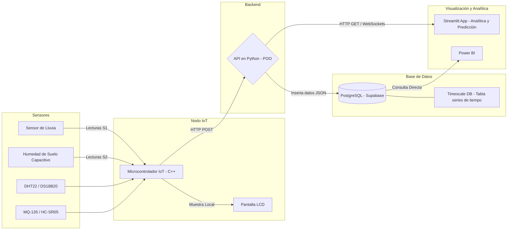

# Arquitectura del Sistema IoT

Este documento describe la arquitectura del sistema IoT diseñado para capturar datos ambientales (especialmente sensores de lluvia y humedad de suelo capacitivos) y procesarlos a través de una API hacia una base de datos, para su posterior análisis.

## Diagrama de Arquitectura (Mermaid)

Puedes copiar y pegar este bloque en herramientas como Notion, GitHub o ChatGPT para que renderice el diagrama visualmente:

## Descripción de los Componentes según el Diagrama

1. **Capa de Sensores y Hardware (El circuito):**
   - **Sensores Principales:** Sensor de lluvia y sensor de humedad de suelo capacitivo que mencionaste. En el tablero también aparecen listados otros sensores de apoyo (DHT22 para temperatura/humedad ambiente, DS18B20 para temperatura sumergible, MQ-135 para calidad de aire, HC-SR05/04 ultrasónico).
   - **Módulo IoT:** Un microcontrolador programado en **C++** (típicamente un ESP32, dado el uso de WiFi). Este lee las señales de los sensores (etiquetados como S1, S2...).
   - **Salida Local:** Cuenta con una pantalla **LCD** para ver los datos directamente en físico sin necesidad de internet.

2. **Capa de Comunicación y Backend (API):**
   - El microcontrolador IoT envía los "Datos" hacia el servidor mediante una petición HTTP **POST**.
   - El servidor central es una **API** programada en **Python** (`py`), desarrollada utilizando principios de Programación Orientada a Objetos (**POO**). Esta API recibe la estructura de datos (probablemente en **JSON**).

3. **Capa de Base de Datos (BD):**
   - La API se conecta a una base de datos **PostgreSQL**.
   - Según el tablero, esta BD está alojada en la plataforma **Supabase** (una excelente alternativa en la nube).
   - Se utiliza **Timescale DB** (una extensión de PostgreSQL) para crear tablas especializadas (ej. `Table temp`) que optimizan el manejo de métricas en series de tiempo (guardar datos cada minuto/hora a lo largo de los días).

4. **Capa de Análisis y Visualización (Frontend):**
   - **Aplicación Web:** Un panel desarrollado en **Python con Streamlit** enfocado en "Analítica y Predicción". Este panel consume los datos desde la API a través de peticiones HTTP **GET** y probablemente actualiza en tiempo real usando **WebSockets**.
   - **Inteligencia de Negocios (BI):** También hay una conexión a **Power BI (PBI)**, la cual se nutre directamente de la base de datos para crear reportes interactivos y gerenciales sobre el comportamiento del circuito y las variables climáticas.
