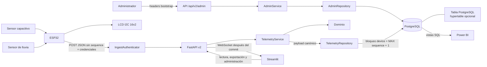
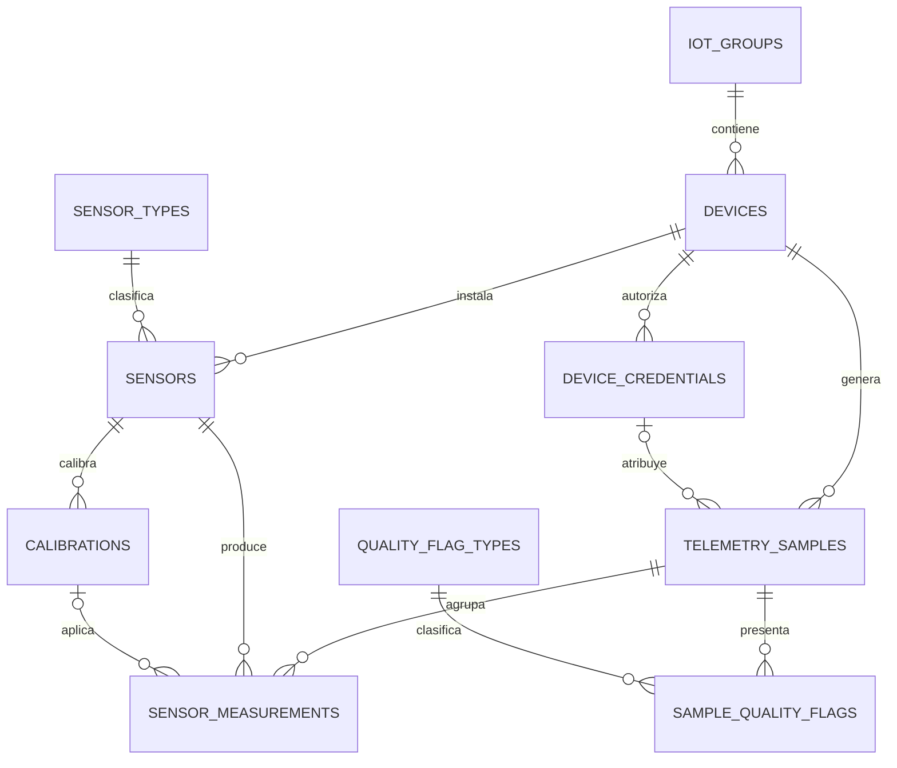

# Arquitectura DDD del proyecto IoT

## Flujo general



La administración registra primero el dispositivo y su inventario, y después emite una credencial. Solo entonces el ESP32 puede enviar telemetría.

## Capas y componentes

- **Dominio:** `TelemetrySample`, lecturas de suelo/lluvia, `IngestPrincipal`, errores de autenticación/autorización/conflicto e interfaces de repositorio.
- **Aplicación:** `TelemetryService`, `AdminService`, comandos y filtros; orquesta reglas sin depender de FastAPI ni psycopg.
- **Infraestructura:** pool psycopg, `PostgresTelemetryRepository`, `PostgresAdminRepository`, hashing HMAC/scrypt, autenticadores, PostgreSQL portable con TimescaleDB opcional y renderizadores.
- **API:** routers de telemetría, administración y compatibilidad; DTO estrictos, dependencias, middleware y WebSocket.
- **Presentación:** Streamlit con cinco páginas y firmware ESP32 autenticado; ambos envían telemetría sin `sequence`, no mantienen contadores locales y muestran la secuencia devuelta por el backend.

La dirección de dependencias sigue API → aplicación → dominio; infraestructura implementa los puertos del dominio y se compone en `main.py`.

## Administración y seguridad

`/api/v2/admin/*` exige:

```http
X-Admin-API-Key: <ADMIN_API_KEY>
X-Admin-Secret-Key: <ADMIN_SECRET_KEY>
```

La administración permite:

- registrar/listar dispositivos;
- activar, desactivar y cambiar alias;
- emitir/listar/revocar credenciales.

El registro administrativo crea grupo, dispositivo, sensores y calibraciones iniciales dentro de una transacción. La emisión devuelve la API key y el secret completos solo una vez; PostgreSQL conserva digest, prefijo, salt y hash.

La ingesta exige:

```http
X-API-Key: ak_...
X-Secret-Key: sk_...
```

No hay usuarios humanos, sesiones ni roles persistidos. Las credenciales bootstrap protegen administración y las credenciales por dispositivo protegen ingesta.

## Persistencia transaccional de una muestra

Una ingesta ejecuta este flujo:

1. autentica inicialmente la API key y el secret y obtiene un principal sin secretos;
2. valida que grupo/dispositivo del payload coincidan con la credencial; el cliente no envía `sequence` y cualquier valor legado opcional se ignora;
3. calcula el fingerprint del payload canónico sin `sequence`, incluyendo `measured_at`;
4. abre transacción, revalida credencial activa, revocación y dispositivo activo, y bloquea la fila de `devices`;
5. vuelve a autorizar identidad y grupo;
6. busca por dispositivo el mismo `payload_sha256`: si existe, devuelve la muestra ya persistida; si no, calcula `MAX(sequence) + 1`, empezando en `0`;
7. actualiza `last_seen_at` e inserta la cabecera con la secuencia asignada, credencial, snapshots de alias y `payload_sha256`;
8. resuelve sensores y calibraciones **ya registrados**; nunca autoaprovisiona durante ingesta;
9. inserta dos filas en `sensor_measurements` y las banderas de calidad si la muestra es nueva;
10. confirma la transacción y solo después publica el evento WebSocket para una muestra nueva.

Idempotencia y respuestas:

- `201`: payload diferente/nuevo, persistido con la siguiente secuencia del dispositivo;
- `200`: retry exacto del payload canónico, con el mismo `measured_at`; devuelve la misma muestra y secuencia sin duplicar detalles ni evento;
- `401`: autenticación inválida, credencial revocada o dispositivo inactivo;
- `403`: credencial válida para otra identidad;
- `409`: reservado para conflictos administrativos, no para el flujo normal de ingesta por secuencia.

`UNIQUE(device_id, sequence)` conserva la numeración como invariante y defensa de concurrencia; la idempotencia se decide por el payload canónico, no por esa restricción.

## Modelo relacional



El esquema final contiene **12 tablas físicas**, **12 claves foráneas documentadas** y **10 tablas relacionadas**: organización, inventario, telemetría, calidad y seguridad. `legacy_records` conserva compatibilidad v1 y `schema_migrations` controla `001_initial`, `002_device_credentials` y `003_postgresql_portability`. `sensor_measurements` es una tabla indexada en Supabase y una hypertable en instalaciones con TimescaleDB.

`telemetry_samples` conserva:

- `id` como clave primaria y `sequence` asignada atómicamente por el backend para cada dispositivo desde `0`;
- la restricción `UNIQUE(device_id, sequence)` como invariante defensiva, no como clave de idempotencia;
- referencia opcional a la credencial de ingesta;
- snapshot del alias del dispositivo;
- snapshot del alias de la credencial;
- fingerprint SHA-256 del payload canónico sin `sequence` e incluyendo `measured_at`.

Así, un retry exacto recupera la misma muestra y renombrar o revocar después no borra la atribución histórica. Un payload diferente crea una muestra con la siguiente secuencia.

## Consultas y Power BI

- `vw_telemetry_wide`: una fila por muestra con ambas variables, estados, flags, alias histórico, autor de inserción, credencial y fingerprint.
- `vw_powerbi_daily_summary`: resumen diario por grupo/dispositivo para KPIs.
- La API comparte filtros por grupo, dispositivo, fechas, variable y rango entre consulta y exportación.

## Frontend

`streamlit_app.py` registra cinco páginas:

- `catalog.py`: monitoreo, filtros, tiempo real y exportación; presenta la secuencia devuelta por la API;
- `register.py`: simulador de ingesta autenticada que envía `measured_at` y lecturas sin `sequence`, y muestra la secuencia asignada por el backend;
- `admin.py`: dispositivos y credenciales;
- `analytics.py`: limpieza, EDA, correlación e IQR;
- `models.py`: persistencia, regresión lineal y k-NN.

`api_client.py` centraliza operaciones públicas, headers de dispositivo y headers administrativos. `realtime.py` escucha WebSocket e invalida caché para consultar nuevamente la API. Ni Streamlit ni el firmware usan `Preferences`, NVS o un contador local para numerar muestras; el firmware envía el payload sin `sequence` y trata `200` como retry exacto y `201` como creación nueva.

## Límites conocidos

- Las rutas de lectura, exportación y WebSocket no requieren autenticación en la versión actual.
- El transporte local es HTTP; producción requiere HTTPS, proxy inverso, secretos externos y rate limiting.
- WebSocket está en memoria y requiere un broker para varias réplicas.
- Las credenciales bootstrap no sustituyen cuentas humanas, roles ni auditoría de administradores.
- Los porcentajes dependen de calibración física real.
- Los modelos son demostrativos y requieren más datos para decisiones agronómicas.
- Power BI Desktop no está disponible en macOS; el `.pbix` debe ensamblarse en Windows con `powerbi/README.md`.
