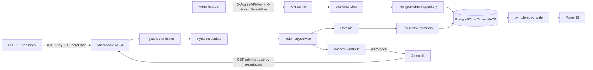

# Documentación técnica integral del código

## 1. Propósito y alcance

La solución recibe telemetría agrícola de ESP32, la valida, autentica el dispositivo, la persiste en PostgreSQL/TimescaleDB, publica eventos WebSocket y la presenta en Streamlit y Power BI. También incorpora una API administrativa para registrar dispositivos, gestionar alias/estado y emitir o revocar credenciales.

Se miden humedad capacitiva del suelo y humedad/lluvia superficial, junto con identidad, secuencia, fecha, periodo, estados derivados, banderas de calidad y trazabilidad de la credencial de ingesta.

El manejo global de errores evita que una petición inválida o una excepción ordinaria termine la API. No protege contra OOM, terminación del contenedor, caída del host o indisponibilidad total de PostgreSQL; Docker aporta healthchecks y `restart: unless-stopped`.

## 2. Arquitectura general



Capas:

1. **API:** routers HTTP/WebSocket, DTO, dependencias y errores.
2. **Aplicación:** comandos, filtros y servicios de telemetría, administración y compatibilidad.
3. **Dominio:** entidades, identidad autenticada, errores e interfaces de repositorio.
4. **Infraestructura:** configuración, seguridad criptográfica, pool, repositorios y renderizadores.
5. **Presentación:** Streamlit y firmware consumen contratos públicos de API.

## 3. Mapa del proyecto

```text
backend/
├── app/
│   ├── main.py
│   ├── api/
│   │   ├── admin_schemas.py              # DTO estrictos de administración
│   │   ├── dependencies.py               # servicios y autenticadores en app.state
│   │   ├── error_handling.py             # middleware y handlers 4xx/5xx
│   │   ├── realtime.py                   # hub WebSocket
│   │   ├── schemas.py                    # DTO API v1
│   │   ├── telemetry_schemas.py          # DTO telemetría v2
│   │   └── routers/
│   │       ├── admin.py                  # dispositivos y credenciales
│   │       ├── records.py                # compatibilidad v1
│   │       └── telemetry.py              # ingesta, consultas y eventos v2
│   ├── application/
│   │   ├── admin_service.py              # casos de uso administrativos y autenticación de ingesta
│   │   ├── commands.py
│   │   ├── errors.py                     # errores de auth/autorización/conflicto
│   │   ├── exports.py
│   │   ├── services.py
│   │   └── telemetry_service.py
│   ├── domain/
│   │   ├── auth.py                       # principal de ingesta sin secretos
│   │   ├── entities.py
│   │   ├── repositories.py
│   │   └── telemetry.py
│   └── infrastructure/
│       ├── config.py
│       ├── database.py
│       ├── postgres_admin_repository.py  # alta, credenciales y autenticación
│       ├── postgres_record_repository.py
│       ├── postgres_telemetry_repository.py
│       ├── security.py                   # HMAC, scrypt y auth bootstrap
│       ├── record_export_renderer.py
│       └── telemetry_export_renderer.py
├── migrations/
│   ├── 001_initial.sql
│   └── 002_device_credentials.sql
└── requirements-api.txt

frontend/
├── streamlit_app.py
├── api_client.py                         # HTTP, descargas y operaciones admin
├── realtime.py
├── services.py
├── prediction.py
├── app_pages/
│   ├── catalog.py
│   ├── register.py
│   ├── admin.py                          # página Administración
│   ├── analytics.py
│   └── models.py
└── tests/test_prediction.py

firmware/esp32_agro_iot/
├── esp32_agro_iot.ino
└── README.md
```

## 4. Composición y ciclo de vida de FastAPI

`backend/app/main.py` realiza al arrancar:

1. carga y valida `Settings`;
2. abre el pool PostgreSQL;
3. ejecuta `verify_schema()`;
4. construye `CredentialHasher`, repositorios, autenticadores, servicios, renderizadores y hub WebSocket;
5. guarda las dependencias compartidas en `app.state`;
6. registra routers y sirve tráfico solo si el esquema requerido está listo.

`verify_schema()` comprueba las 10 tablas relacionadas requeridas, el marcador `002_device_credentials`, la extensión TimescaleDB y la hypertable `sensor_measurements`. No reemplaza una auditoría completa de columnas, índices, vistas o contratos. La ausencia de base, migración o hypertable detiene el arranque.

Al apagar, se cierran conexiones WebSocket y pool. Rutas de salud:

- `GET /health` y `GET /health/live`: proceso activo.
- `GET /health/ready`: pool, PostgreSQL, migraciones y TimescaleDB listos.

## 5. Manejo global de errores

`ErrorHandlingMiddleware` es ASGI puro. Asigna o valida `X-Request-ID`, mide tiempo, limita cuerpos, exige JSON en los POST configurados, oculta detalles internos y agrega a cada respuesta:

```http
X-Request-ID: <uuid-o-id-seguro>
X-Process-Time-Ms: <duración>
```

Contrato:

```json
{
  "error": {
    "code": "VALIDATION_ERROR",
    "message": "Revise los campos indicados.",
    "details": [],
    "request_id": "8c598615-42f9-4e91-a7b7-ed746b355b39"
  }
}
```

| HTTP | Código | Uso |
|---:|---|---|
| 400 | `BAD_REQUEST` | solicitud o longitud inválida |
| 401 | `AUTHENTICATION_REQUIRED` | headers ausentes/incorrectos, credencial revocada o dispositivo inactivo |
| 403 | `FORBIDDEN` | credencial válida usada para otro grupo/dispositivo |
| 404 | `NOT_FOUND` | ruta, dispositivo o credencial inexistente |
| 405 | `METHOD_NOT_ALLOWED` | verbo no permitido |
| 409 | `CONFLICT` | recurso duplicado o misma secuencia con payload distinto |
| 413 | `PAYLOAD_TOO_LARGE` | cuerpo sobre el límite |
| 415 | `UNSUPPORTED_MEDIA_TYPE` | POST esperado sin JSON |
| 422 | `VALIDATION_ERROR` | DTO, filtro o dominio inválido |
| 503 | `DATABASE_UNAVAILABLE` | PostgreSQL/pool no disponible |
| 504 | `UPSTREAM_TIMEOUT` | dependencia excedió timeout |
| 500 | `INTERNAL_ERROR` | excepción inesperada con respuesta opaca |

Las respuestas `401` incluyen `WWW-Authenticate: ApiKey`. La emisión de credenciales incluye `Cache-Control: no-store` y `Pragma: no-cache` para evitar almacenar los secretos mostrados una sola vez.

## 6. Validación y autenticación

### 6.1 Telemetría v2

`telemetry_schemas.py` usa Pydantic v2 estricto, `extra="forbid"` y números finitos. Reglas principales: versión literal `2.0`; IDs de 2–64 caracteres; secuencia BIGINT no negativa; fecha ISO-8601 con zona; periodo 5 o 10; ADC 0–4095; porcentajes 0–100; booleano real para lluvia.

### 6.2 Credenciales de dispositivo

La ingesta exige:

```http
X-API-Key: ak_...
X-Secret-Key: sk_...
```

`CredentialHasher` genera las claves, localiza la API key mediante HMAC-SHA256 con `CREDENTIAL_PEPPER` y verifica el secret mediante scrypt con salt. PostgreSQL conserva digest, prefijo, salt y hash, nunca las claves completas. La comparación administrativa usa funciones de comparación resistentes a diferencias temporales.

### 6.3 Administración

Toda ruta `/api/v2/admin/*` exige:

```http
X-Admin-API-Key: <ADMIN_API_KEY>
X-Admin-Secret-Key: <ADMIN_SECRET_KEY>
```

Estas credenciales bootstrap provienen del entorno; no representan un usuario humano ni se persisten como cuenta o sesión.

## 7. API y flujos cruciales

### 7.1 Telemetría y consulta

```text
POST /api/v2/telemetry/samples
GET  /api/v2/telemetry/samples
GET  /api/v2/telemetry/devices
GET  /api/v2/telemetry/groups
GET  /api/v2/telemetry/export/{csv|json|xlsx|pdf}
WS   /api/v2/telemetry/events
```

Solo el POST de ingesta exige credenciales de dispositivo. Las consultas, catálogos, exportaciones y WebSocket no tienen autenticación en la implementación actual.

### 7.2 Endpoints administrativos

```text
POST /api/v2/admin/devices
GET  /api/v2/admin/devices
POST /api/v2/admin/devices/{device_id}/activate
POST /api/v2/admin/devices/{device_id}/deactivate
POST /api/v2/admin/devices/{device_id}/alias
POST /api/v2/admin/credentials
GET  /api/v2/admin/credentials
POST /api/v2/admin/credentials/{credential_id}/revoke
```

Cuerpos principales:

```json
{"group_id":"grupo-01","device_id":"esp32-grupo-01","alias":"Parcela norte"}
```

```json
{"device_id":"esp32-grupo-01","alias":"Credencial firmware"}
```

```json
{"alias":"Nuevo alias"}
```

Registrar un dispositivo aprovisiona administrativamente grupo, dispositivo, sensores y calibraciones iniciales en una transacción. Emitir credencial entrega `api_key` y `secret_key` solo en esa respuesta. El listado posterior contiene prefijo, alias, estado y fechas, no secretos.

### 7.3 Flujo de ingesta autenticada

1. El middleware limita cuerpo, exige JSON y asigna `request_id`.
2. `IngestAuthenticator` valida `X-API-Key` y `X-Secret-Key` y crea un `IngestPrincipal` sin secretos.
3. Pydantic y dominio validan payload, valores y flags.
4. `TelemetryService` exige que grupo/dispositivo del payload coincidan con el principal.
5. Dentro de la transacción, el repositorio revalida credencial y dispositivo con bloqueo compartido para cerrar la carrera frente a revocación o desactivación.
6. Se vuelven a verificar grupo e identidad. La ingesta **no** crea grupos, dispositivos, sensores ni calibraciones.
7. Se calcula/usa el fingerprint canónico y se inserta `telemetry_samples` con snapshots del alias del dispositivo y de la credencial.
8. Si es nueva, se insertan dos mediciones y flags usando el inventario ya registrado.
9. Tras el commit, solo una creación nueva publica WebSocket.

Semántica:

- `201`: muestra nueva, `duplicate=false`;
- `200`: mismo dispositivo, secuencia y fingerprint, `duplicate=true`;
- `409`: mismo dispositivo/secuencia con contenido diferente; el original no se sustituye;
- `401`: autenticación ausente/incorrecta, credencial revocada o dispositivo inactivo;
- `403`: credencial válida para una identidad distinta a la declarada.

### 7.4 Compatibilidad v1

```text
POST /api/v1/records
GET  /api/v1/records
GET  /api/v1/records/export/{csv|json|xlsx|pdf}
WS   /api/v1/records/events
```

La API v1 persiste objetos JSONB flexibles en `legacy_records` y está marcada como obsoleta. Se mantiene para consumidores anteriores.

## 8. WebSocket y exportaciones

`RecordEventHub` mantiene clientes en memoria. Un fallo de un cliente no cancela publicaciones a otros. Las muestras se publican solo después del commit y los duplicados no repiten evento.

Los renderizadores generan CSV, JSON, XLSX y PDF en threadpool. Las descargas incluyen `Content-Disposition` y `X-Content-Type-Options: nosniff`; los filtros coinciden con los de consulta.

## 9. PostgreSQL y TimescaleDB

Las migraciones se ejecutan en orden:

- **`001_initial.sql`:** esquema base, catálogos, restricciones, índices, hypertable, vistas y compatibilidad v1.
- **`002_device_credentials.sql`:** tabla de credenciales, FK de ingesta, snapshots de alias, fingerprint, índices de seguridad y vista ancha actualizada.

El resultado es **12 tablas físicas**, **12 claves foráneas documentadas** y **10 tablas IoT/seguridad relacionadas**. `legacy_records` es compatibilidad y `schema_migrations` es control técnico.

Tablas relacionadas:

```text
iot_groups, devices, sensor_types, sensors, calibrations,
telemetry_samples, sensor_measurements, quality_flag_types,
sample_quality_flags, device_credentials
```

`sensor_measurements` es la hypertable por `measured_at`. `telemetry_samples(device_id, sequence)` mantiene idempotencia. `vw_telemetry_wide` expone mediciones, flags, alias histórico, autor de inserción, credencial y fingerprint; `vw_powerbi_daily_summary` agrega por día/grupo/dispositivo.

## 10. Streamlit

`frontend/streamlit_app.py` registra cinco páginas:

1. **Monitoreo (`catalog.py`):** filtros, tabla, gráficos, tiempo real y CSV visible.
2. **Simulador ESP32 (`register.py`):** payload v2 con credenciales de dispositivo.
3. **Administración (`admin.py`):** registro/estado/alias de dispositivos y emisión/listado/revocación de credenciales.
4. **Análisis exploratorio (`analytics.py`):** limpieza, descriptivos, Pearson, distribución e IQR.
5. **Modelos predictivos (`models.py`):** baseline, regresión lineal y k-NN con corte temporal.

`api_client.py` centraliza los headers de dispositivo/admin, timeouts, errores y descargas. La UI no usa SQL ni psycopg.

## 11. Modelos predictivos

`frontend/prediction.py` es puro, sin Streamlit ni I/O. Conserva trazabilidad, forma pares consecutivos por dispositivo, rechaza gaps excesivos y aplica división temporal purgada:

```text
max(train.target_time) < min(test.fecha)
```

Compara persistencia, regresión lineal y k-NN. Reporta MAE, RMSE, R² y bias, y recorta resultados a 0–100 %. Las pruebas sintéticas están en `frontend/tests/test_prediction.py`. Es una demostración académica, no una recomendación agronómica.

## 12. Firmware

`firmware/esp32_agro_iot/esp32_agro_iot.ino`:

- lee sensores y muestra estado en LCD;
- obtiene hora NTP para `measured_at`;
- configura grupo/dispositivo ya registrados;
- envía `X-API-Key` y `X-Secret-Key`;
- persiste la secuencia en NVS mediante `Preferences`;
- incrementa secuencia solo con HTTP `200` o `201`;
- trata `409` como conflicto que requiere revisar el reintento/payload;
- maneja reconexión WiFi/HTTP.

Las claves deben emitirse antes de instalar el firmware y no deben compartirse ni publicarse. Fuera de desarrollo, el transporte debe ser HTTPS.

## 13. Configuración

| Variable | Función |
|---|---|
| `POSTGRES_USER`, `POSTGRES_PASSWORD`, `POSTGRES_DB`, `POSTGRES_PORT` | PostgreSQL |
| `DATABASE_URL` | DSN de la API |
| `DATABASE_POOL_MIN_SIZE`, `DATABASE_POOL_MAX_SIZE` | límites del pool |
| `CORS_ORIGINS` | orígenes permitidos por navegador |
| `MAX_TELEMETRY_BODY_BYTES` | límite de ingesta v2 |
| `MAX_LEGACY_BODY_BYTES` | límite de API v1 |
| `CREDENTIAL_PEPPER` | HMAC de API keys; mínimo 32 caracteres |
| `ADMIN_API_KEY` | API key bootstrap admin; mínimo 16 caracteres |
| `ADMIN_SECRET_KEY` | secret bootstrap admin; mínimo 24 caracteres |
| `API_PORT`, `FRONTEND_PORT`, `API_BASE_URL` | publicación y cliente Streamlit |

Los valores de ejemplo de los tres secretos deben reemplazarse antes de iniciar. Cambiar `CREDENTIAL_PEPPER` después de emitir credenciales impide localizar sus API keys existentes.

## 14. Despliegue y operación

Orden de Compose: PostgreSQL saludable → migraciones `001` y `002` → API lista → frontend saludable.

```bash
cp .env.example .env
# Editar .env y cambiar POSTGRES_PASSWORD, CREDENTIAL_PEPPER,
# ADMIN_API_KEY y ADMIN_SECRET_KEY.
docker compose up --build -d
docker compose ps
```

Diagnóstico: consultar primero el `X-Request-ID` del cliente y después `docker compose logs api postgres migrate frontend`. No usar `docker compose down -v` salvo que se quiera borrar permanentemente el volumen.

## 15. Seguridad y limitaciones

- Hay autenticación de dispositivo para ingesta y autenticación bootstrap para administración.
- No hay cuentas, sesiones ni roles de usuarios humanos.
- Los endpoints de lectura, exportación y WebSocket son públicos en la implementación actual; no se debe exponer la API directamente a Internet.
- HTTP local no aporta confidencialidad. Producción requiere TLS, proxy inverso, gestión externa de secretos, rate limiting, backups y observabilidad.
- CORS no protege clientes no navegadores y no sustituye autenticación.
- El hub WebSocket en memoria requiere un broker para varias réplicas.
- La API oculta trazas y secretos al cliente, pero los operadores deben proteger logs, `.env` y backups.
- Power BI Desktop y `.pbix` requieren Windows; en macOS se validan SQL, vistas y documentación.
- Hardware, cableado y calibración física no pueden demostrarse solo con software.

## 16. Archivos esenciales

Orden recomendado:

1. `backend/app/main.py` — composición y lifespan.
2. `backend/app/api/dependencies.py` — autenticación y dependencias.
3. `backend/app/api/error_handling.py` — frontera de errores.
4. `backend/app/api/routers/admin.py` y `admin_schemas.py` — contrato administrativo.
5. `backend/app/infrastructure/security.py` — hashing y bootstrap admin.
6. `backend/app/infrastructure/postgres_admin_repository.py` — alta, credenciales y autenticación.
7. `backend/app/domain/auth.py` y `application/errors.py` — principal y errores.
8. `backend/app/api/telemetry_schemas.py` y `application/telemetry_service.py` — contrato/caso de uso v2.
9. `backend/app/infrastructure/postgres_telemetry_repository.py` — revalidación, idempotencia y transacción.
10. `backend/migrations/001_initial.sql` y `002_device_credentials.sql` — modelo persistente.
11. `frontend/api_client.py`, `streamlit_app.py` y `app_pages/admin.py` — consumo y administración.
12. `firmware/esp32_agro_iot/esp32_agro_iot.ino` — cliente físico autenticado.
13. `frontend/prediction.py` y `frontend/tests/test_prediction.py` — modelos y evidencia matemática.
