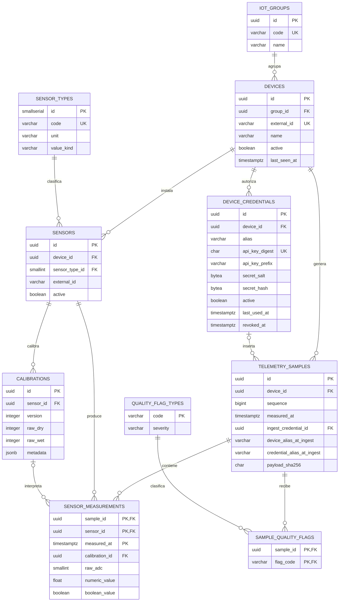

# Modelo de datos PostgreSQL/TimescaleDB

## 1. Resumen

El esquema actual tiene **12 tablas físicas**, **12 claves foráneas documentadas**, **10 tablas IoT y de seguridad relacionadas**, **1 tabla de compatibilidad**, **1 tabla técnica**, **1 hypertable TimescaleDB** y **2 vistas**.

```text
12 tablas físicas
├── 10 relacionadas
│   ├── Organización: iot_groups, devices
│   ├── Inventario: sensor_types, sensors, calibrations
│   ├── Telemetría: telemetry_samples, sensor_measurements
│   ├── Calidad: quality_flag_types, sample_quality_flags
│   └── Seguridad: device_credentials
├── Compatibilidad: legacy_records
└── Control técnico: schema_migrations

Objetos derivados
├── vw_telemetry_wide
└── vw_powerbi_daily_summary
```

Las tablas separan datos maestros, inventario, calibraciones, eventos, valores temporales, calidad, credenciales, compatibilidad y control de migraciones. Esta normalización evita duplicación y conserva trazabilidad histórica.

## 2. Diagrama entidad–relación



`legacy_records` y `schema_migrations` permanecen aisladas del grafo del negocio: la primera conserva la API v1 y la segunda registra las migraciones aplicadas.

## 3. Conectividad y volumen

Por conectividad directa, `devices`, `sensors` y `telemetry_samples` enlazan cuatro tablas vecinas cada una. `sensor_measurements` conecta muestras, sensores y calibraciones, pero es la tabla que más filas acumula porque cada muestra genera normalmente dos mediciones.

| Tabla | Vecinos directos | Función central |
|---|---:|---|
| `devices` | 4 | grupo, sensores, muestras y credenciales |
| `sensors` | 4 | dispositivo, tipo, calibraciones y mediciones |
| `telemetry_samples` | 4 | dispositivo, credencial, mediciones y flags |
| `sensor_measurements` | 3 | detalle temporal de cada sensor |
| `device_credentials` | 2 | dispositivo autorizado y muestras atribuidas |
| `calibrations` | 2 | sensor e interpretación histórica |
| `sample_quality_flags` | 2 | puente muestra–tipo de alerta |

Con un periodo de cinco segundos, un dispositivo puede producir unas 17.280 muestras y 34.560 mediciones por día. Por eso `sensor_measurements`, no los catálogos, se convierte en hypertable.

## 4. Mapa de claves foráneas

| # | Tabla hija y columna | Tabla padre | Cardinalidad | Al borrar el padre |
|---:|---|---|---|---|
| 1 | `devices.group_id` | `iot_groups.id` | grupo 1:N dispositivos | `RESTRICT` |
| 2 | `sensors.device_id` | `devices.id` | dispositivo 1:N sensores | `CASCADE` |
| 3 | `sensors.sensor_type_id` | `sensor_types.id` | tipo 1:N sensores | `RESTRICT` |
| 4 | `calibrations.sensor_id` | `sensors.id` | sensor 1:N calibraciones | `CASCADE` |
| 5 | `telemetry_samples.device_id` | `devices.id` | dispositivo 1:N muestras | `RESTRICT` |
| 6 | `sensor_measurements.sample_id` | `telemetry_samples.id` | muestra 1:N mediciones | `CASCADE` |
| 7 | `sensor_measurements.sensor_id` | `sensors.id` | sensor 1:N mediciones | `RESTRICT` |
| 8 | `sensor_measurements.calibration_id` | `calibrations.id` | calibración 1:N mediciones | `SET NULL` |
| 9 | `sample_quality_flags.sample_id` | `telemetry_samples.id` | muestra 1:N flags | `CASCADE` |
| 10 | `sample_quality_flags.flag_code` | `quality_flag_types.code` | tipo 1:N asociaciones | `RESTRICT` |
| 11 | `device_credentials.device_id` | `devices.id` | dispositivo 1:N credenciales | `CASCADE` |
| 12 | `telemetry_samples.ingest_credential_id` | `device_credentials.id` | credencial 1:N muestras | `SET NULL` |

Las dos relaciones de seguridad garantizan que una credencial pertenece a un dispositivo y que una muestra puede conservar la referencia a la credencial que la insertó. Si se borra un dispositivo, sus credenciales desaparecen por `CASCADE`; si se elimina una credencial, la muestra histórica permanece y `ingest_credential_id` pasa a `NULL`.

## 5. Responsabilidad de las tablas

### Organización e inventario

- **`iot_groups`:** agrupación académica u operativa identificada por `code`.
- **`devices`:** ESP32 registrado, con identidad externa, alias, estado activo y `last_seen_at`.
- **`sensor_types`:** catálogo reusable de variables, unidad, clase y rango.
- **`sensors`:** instalación concreta de un sensor en un dispositivo.
- **`calibrations`:** versiones de calibración por sensor con intervalos de vigencia.

El alta administrativa del dispositivo crea su inventario inicial de sensores y calibraciones. La ingesta no crea estos datos.

### Telemetría y trazabilidad

#### `telemetry_samples`

Representa un POST completo aceptado. Incluye:

- `UNIQUE(device_id, sequence)` para idempotencia;
- `measured_at`, `received_at` y periodo de muestreo;
- estados derivados de suelo y lluvia;
- `ingest_credential_id`, referencia opcional a la credencial autenticada;
- `device_alias_at_ingest`, snapshot del alias del dispositivo;
- `credential_alias_at_ingest`, snapshot del alias de la credencial;
- `payload_sha256`, fingerprint canónico usado para distinguir un reintento idéntico de un conflicto.

Los snapshots no cambian si después se renombra el dispositivo o la credencial. La vista expone estos datos como `device_alias`, `inserted_by_alias`, `ingest_credential_id` y `payload_sha256`.

#### `sensor_measurements`

Contiene una fila por sensor y muestra. Su PK es `(sample_id, sensor_id, measured_at)`, valida ADC 0–4095 y porcentajes 0–100, y es la hypertable particionada por `measured_at` en intervalos de siete días.

### Calidad

- **`quality_flag_types`:** catálogo de alertas y severidad.
- **`sample_quality_flags`:** relación N:M entre muestras y alertas. Su PK evita repetir el mismo flag en una muestra.

### Seguridad: `device_credentials`

Cada fila representa una credencial emitida para un dispositivo:

- no guarda API key ni secret en claro;
- conserva digest de API key, prefijo visible, salt y hash del secret;
- permite varias credenciales por dispositivo;
- registra alias, creación, último uso, estado y revocación;
- permite revocar una credencial sin borrar el historial de muestras.

La API key y el secret completos se entregan únicamente al emitir la credencial. El listado administrativo devuelve metadatos, no secretos.

### Compatibilidad y operación

- **`legacy_records`:** objetos JSONB de la API v1; no participa en ingesta v2.
- **`schema_migrations`:** marcadores `001_initial` y `002_device_credentials`.

## 6. Flujo de administración e ingesta

```mermaid
sequenceDiagram
    participant ADM as Administrador
    participant API as FastAPI
    participant C as device_credentials
    participant D as devices/sensors
    participant T as telemetry_samples
    participant M as sensor_measurements
    participant Q as sample_quality_flags

    ADM->>API: alta de dispositivo con headers admin
    API->>D: crea grupo/dispositivo/sensores/calibraciones
    ADM->>API: emite credencial con headers admin
    API->>C: guarda digest, salt y hash

    API->>C: autentica X-API-Key + X-Secret-Key
    API->>C: revalida credencial activa dentro de transacción
    API->>D: revalida dispositivo, grupo e identidad
    Note over API,D: nunca autoaprovisiona durante ingesta
    API->>T: inserta cabecera, snapshots y fingerprint
    alt muestra nueva
        API->>M: inserta mediciones existentes
        API->>Q: asocia flags calculados
        API-->>API: commit; después publica WebSocket
    else reintento idéntico
        API-->>API: devuelve la muestra existente
    else misma secuencia y payload diferente
        API-->>API: conflicto; no reemplaza la muestra
    end
```

La autenticación inicial ocurre antes del caso de uso y la credencial se revalida dentro de la transacción para cerrar la carrera con una revocación o desactivación concurrente. Una credencial no puede enviar telemetría para otro grupo o dispositivo.

## 7. Migraciones

### `001_initial.sql`

Crea TimescaleDB, el modelo inicial, catálogos, restricciones, índices, hypertable, vistas, compatibilidad v1 y `schema_migrations`.

### `002_device_credentials.sql`

En una transacción:

1. crea `device_credentials` e índice por dispositivo/estado;
2. añade a `telemetry_samples` la credencial de ingesta, snapshots de alias y fingerprint;
3. añade la FK con `ON DELETE SET NULL` y el índice temporal por credencial;
4. completa el alias histórico del dispositivo cuando es posible;
5. reemplaza `vw_telemetry_wide` para exponer trazabilidad;
6. registra `002_device_credentials`.

## 8. TimescaleDB y vistas

Solo `sensor_measurements` es hypertable porque concentra el crecimiento temporal. `telemetry_samples` sigue siendo tabla PostgreSQL para mantener de forma sencilla la unicidad `(device_id, sequence)`.

- **`vw_telemetry_wide`:** una fila por muestra con grupo, dispositivo, mediciones, estados, flags, snapshots, credencial y fingerprint.
- **`vw_powerbi_daily_summary`:** resumen diario por grupo y dispositivo para KPIs.

Las vistas no almacenan copias y no cuentan entre las 12 tablas físicas.

## 9. Restricciones e índices principales

Restricciones relevantes: secuencia no negativa; periodo de 5 o 10 segundos; versión `2.0`; ADC 0–4095; porcentajes 0–100; timestamps con zona; estados y severidades enumerados; digest de API key único.

| Índice | Objetivo |
|---|---|
| `devices_group_idx` | dispositivos por grupo |
| `sensors_device_idx` | sensores por dispositivo |
| `sensors_type_idx` | sensores por tipo |
| `telemetry_samples_measured_idx` | historial temporal global |
| `telemetry_samples_device_time_idx` | historial por dispositivo |
| `telemetry_samples_credential_idx` | muestras por credencial y fecha |
| `sensor_measurements_sensor_time_idx` | serie temporal por sensor |
| `sensor_measurements_sample_idx` | reconstrucción de una muestra |
| `sample_quality_flags_code_idx` | muestras por alerta |
| `device_credentials_device_idx` | credenciales activas por dispositivo |
| `legacy_records_created_idx` | compatibilidad v1 por fecha |

## 10. Usuarios humanos y autenticación

No existen cuentas, sesiones, roles ni tablas de usuarios humanos. Sí existen dos mecanismos de autenticación:

- API key + secret por dispositivo para `POST /api/v2/telemetry/samples`;
- API key + secret bootstrap de administración para `/api/v2/admin/*`.

`iot_groups` no representa usuarios y `devices` no almacena contraseñas. Si en el futuro se incorporan organizaciones y usuarios humanos, deben agregarse con migraciones y autorización por roles, sin reutilizar estas entidades.

## 11. Consultas de comprobación

### Contar las 12 tablas

```sql
SELECT COUNT(*) AS table_count
FROM information_schema.tables
WHERE table_schema = 'public'
  AND table_type = 'BASE TABLE';
```

### Enumerar claves foráneas

```sql
SELECT tc.table_name AS child_table,
       kcu.column_name AS foreign_key,
       ccu.table_name AS parent_table,
       ccu.column_name AS referenced_column,
       rc.delete_rule
FROM information_schema.table_constraints tc
JOIN information_schema.key_column_usage kcu
  ON kcu.constraint_name = tc.constraint_name
 AND kcu.constraint_schema = tc.constraint_schema
JOIN information_schema.constraint_column_usage ccu
  ON ccu.constraint_name = tc.constraint_name
 AND ccu.constraint_schema = tc.constraint_schema
JOIN information_schema.referential_constraints rc
  ON rc.constraint_name = tc.constraint_name
 AND rc.constraint_schema = tc.constraint_schema
WHERE tc.table_schema = 'public'
  AND tc.constraint_type = 'FOREIGN KEY'
ORDER BY child_table, foreign_key;
```

### Verificar migraciones e hypertable

```sql
SELECT version, applied_at FROM schema_migrations ORDER BY version;

SELECT hypertable_schema, hypertable_name, num_dimensions
FROM timescaledb_information.hypertables
WHERE hypertable_schema = 'public'
  AND hypertable_name = 'sensor_measurements';
```

### Comparar volumen por tabla

```sql
SELECT 'iot_groups' AS table_name, COUNT(*) AS rows FROM iot_groups
UNION ALL SELECT 'devices', COUNT(*) FROM devices
UNION ALL SELECT 'sensor_types', COUNT(*) FROM sensor_types
UNION ALL SELECT 'sensors', COUNT(*) FROM sensors
UNION ALL SELECT 'calibrations', COUNT(*) FROM calibrations
UNION ALL SELECT 'device_credentials', COUNT(*) FROM device_credentials
UNION ALL SELECT 'telemetry_samples', COUNT(*) FROM telemetry_samples
UNION ALL SELECT 'sensor_measurements', COUNT(*) FROM sensor_measurements
UNION ALL SELECT 'quality_flag_types', COUNT(*) FROM quality_flag_types
UNION ALL SELECT 'sample_quality_flags', COUNT(*) FROM sample_quality_flags
UNION ALL SELECT 'legacy_records', COUNT(*) FROM legacy_records
UNION ALL SELECT 'schema_migrations', COUNT(*) FROM schema_migrations
ORDER BY rows DESC;
```

## 12. Conclusión

El modelo actual combina **10 tablas relacionadas**, `legacy_records` y `schema_migrations`, para un total de **12 tablas físicas**. `sensor_measurements` concentra el volumen y es la única hypertable; `telemetry_samples` implementa idempotencia y trazabilidad; `device_credentials` autentica dispositivos sin guardar secretos en claro. Las migraciones `001_initial` y `002_device_credentials` permiten evolucionar el esquema sin autoaprovisionar entidades durante la ingesta.
